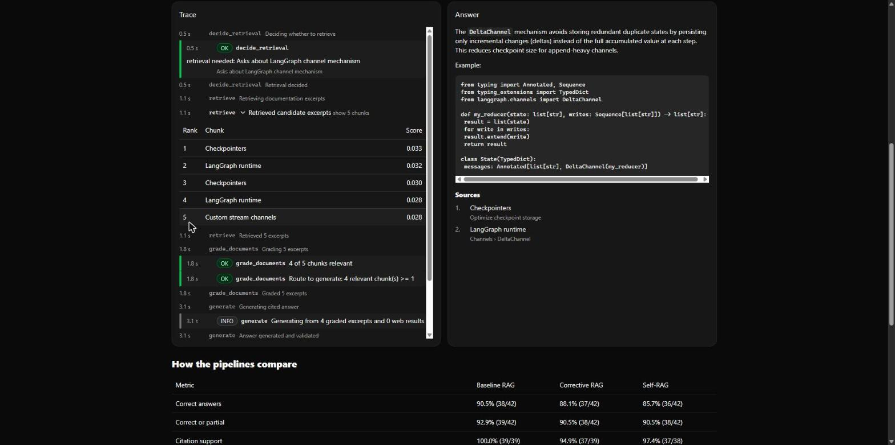
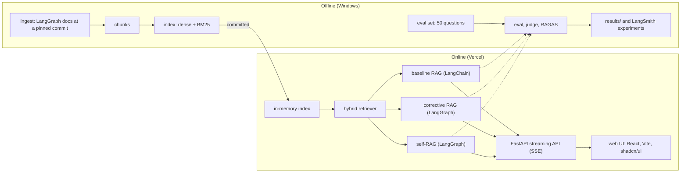
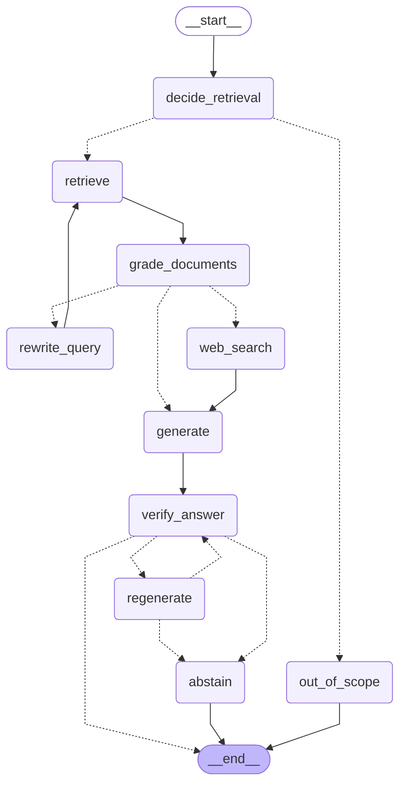
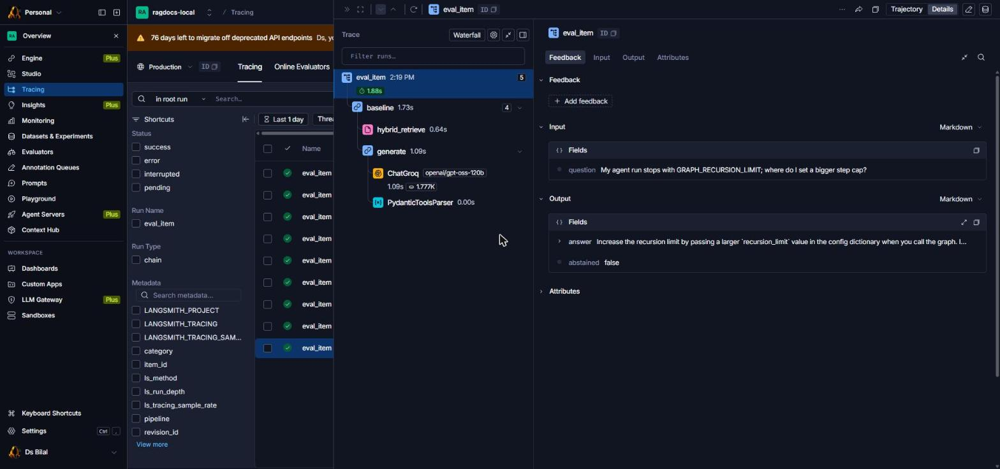
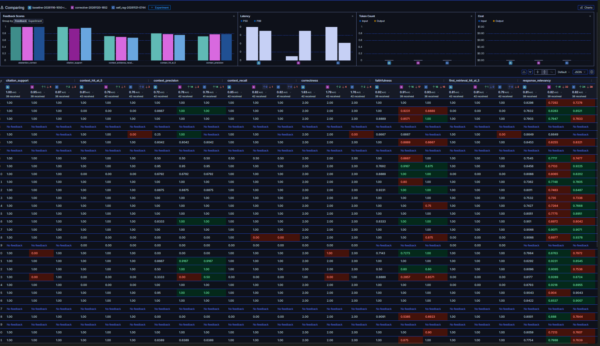

# Agentic RAG Docs Assistant

A question-answering assistant over the LangGraph Python docs that compares a hybrid-retrieval baseline, corrective RAG and self-RAG on a 50-question benchmark.

[](https://github.com/BilalAamir4/Agentic-RAG-Docs-Assistant/actions/workflows/ci.yml)
[Live demo](https://agentic-rag-docs-assistant.vercel.app)

The demo allows 5 questions per hour per visitor and a daily total of 32 questions for all visitors, and runs on free-tier models, so it can be slow or out of quota.



## Key findings

On this 50-question benchmark (42 answerable, 8 unanswerable) over a pinned snapshot of the LangGraph docs, corrective RAG and self-RAG did not answer measurably better than the hybrid baseline: correct answers were 38 of 42 for the baseline, 37 of 42 for corrective RAG and 36 of 42 for self-RAG, and a difference under 3 questions is no measurable difference. The ceiling was low: the baseline left 4 of 42 answerable questions not correct (q008, q024, q025, q029), neither technique fixed any of the 4, and each technique broke 2 questions the baseline had answered or partly answered (corrective: q024, q034; self-RAG: q028, q033, where q033 is labelled a judge disagreement, see Limitations). They cost more per question (n=50): mean tokens 2,334 for the baseline, 4,577 for corrective RAG and 6,847 for self-RAG, and p95 latency 3.7 s, 8.0 s and 9.2 s. The only measurable differences from the baseline besides cost are that corrective RAG used web search on 8 of 50 questions and self-RAG on 7 of 50 (baseline 0 of 50); RAGAS faithfulness, response relevancy, context precision and context recall show no measurable difference for any pair (n=38 to 41 paired items). The reranker failed its gate (D6): hybrid hit@5 was 34 of 42 and 35 of 42 with the reranker, a gain of 1 question against a threshold of 3, and hit@1 fell from 22 to 17 of 42, so production uses hybrid retrieval without it.

Details: [docs/failure-analysis.md](docs/failure-analysis.md) lists every failed question with its label and what each technique fixed and broke.

## Results

<!-- results:start -->
Generated by `py tasks.py readme` from committed files in `results/`; do not edit between the markers.

### Main results

50 questions (42 answerable, 8 unanswerable).

| Metric | Baseline RAG | Corrective RAG | Self-RAG |
|---|---|---|---|
| Correct answers | 90.5% (38/42) | 88.1% (37/42) | 85.7% (36/42) |
| Correct or partial | 92.9% (39/42) | 90.5% (38/42) | 90.5% (38/42) |
| Citation support | 100.0% (39/39) | 94.9% (37/39) | 97.4% (37/38) |
| Unanswerable correctly declined | 100.0% (8/8) | 100.0% (8/8) | 100.0% (8/8) |
| Hallucinated on unanswerable | 0.0% (0/8) | 0.0% (0/8) | 0.0% (0/8) |
| False abstentions | 7.1% (3/42) | 7.1% (3/42) | 9.5% (4/42) |
| First-retrieval hit@5 (like-for-like retrieval) | 81.0% (34/42) | 81.0% (34/42) | 78.6% (33/42) |
| Context hit@5 (on contexts given to the generator) | 81.0% (34/42) | 78.6% (33/42) | 76.2% (32/42) |
| RAGAS faithfulness | 0.92 (n=39) | 0.91 (n=39) | 0.93 (n=38) |
| RAGAS response relevancy | 0.81 (n=39) | 0.82 (n=39) | 0.82 (n=38) |
| RAGAS context precision (on contexts given to the generator) | 0.72 (n=42) | 0.78 (n=42) | 0.79 (n=41) |
| RAGAS context recall (on contexts given to the generator) | 0.85 (n=42) | 0.82 (n=42) | 0.82 (n=41) |
| Web search used | 0.0% (0/50) | 16.0% (8/50) | 14.0% (7/50) |
| Mean LLM calls per question | 1.0 | 2.3 | 4.2 |
| Mean tokens per question | 2,334 | 4,577 | 6,847 |
| Median latency | 2.2 s | 3.2 s | 4.8 s |
| p95 latency | 3.7 s | 8.0 s | 9.2 s |

### Is the difference real?

Counts: a difference under 3 questions is "no measurable difference" (D19). RAGAS: a paired item is a win or loss when its score differs by more than 0.2; the verdict needs wins minus losses of at least 3, over the items scored in all three runs. Citation support counts judged items, and the judged n differs between runs.

#### Corrective RAG vs Baseline RAG

| Count metric | Baseline RAG | Corrective RAG | Difference (questions) | Verdict |
|---|---|---|---|---|
| Correct answers | 38 | 37 | -1 | no measurable difference |
| Correct or partial | 39 | 38 | -1 | no measurable difference |
| Citation support | 39 | 37 | -2 | no measurable difference |
| Unanswerable correctly declined | 8 | 8 | 0 | no measurable difference |
| Hallucinated on unanswerable | 0 | 0 | 0 | no measurable difference |
| False abstentions | 3 | 3 | 0 | no measurable difference |
| First-retrieval hit@5 (like-for-like retrieval) | 34 | 34 | 0 | no measurable difference |
| Context hit@5 (on contexts given to the generator) | 34 | 33 | -1 | no measurable difference |
| Web search used | 0 | 8 | +8 | measurable (+8) |

| RAGAS metric | Paired n | Wins | Losses | Verdict |
|---|---|---|---|---|
| RAGAS faithfulness (prose-level grounding signal) | 38 | 2 | 3 | no measurable difference |
| RAGAS response_relevancy | 38 | 1 | 0 | no measurable difference |
| RAGAS context_precision (on contexts given to the generator) | 41 | 2 | 1 | no measurable difference |
| RAGAS context_recall (on contexts given to the generator) | 41 | 0 | 1 | no measurable difference |

#### Self-RAG vs Baseline RAG

| Count metric | Baseline RAG | Self-RAG | Difference (questions) | Verdict |
|---|---|---|---|---|
| Correct answers | 38 | 36 | -2 | no measurable difference |
| Correct or partial | 39 | 38 | -1 | no measurable difference |
| Citation support | 39 | 37 | -2 | no measurable difference |
| Unanswerable correctly declined | 8 | 8 | 0 | no measurable difference |
| Hallucinated on unanswerable | 0 | 0 | 0 | no measurable difference |
| False abstentions | 3 | 4 | +1 | no measurable difference |
| First-retrieval hit@5 (like-for-like retrieval) | 34 | 33 | -1 | no measurable difference |
| Context hit@5 (on contexts given to the generator) | 34 | 32 | -2 | no measurable difference |
| Web search used | 0 | 7 | +7 | measurable (+7) |

| RAGAS metric | Paired n | Wins | Losses | Verdict |
|---|---|---|---|---|
| RAGAS faithfulness (prose-level grounding signal) | 38 | 3 | 4 | no measurable difference |
| RAGAS response_relevancy | 38 | 1 | 0 | no measurable difference |
| RAGAS context_precision (on contexts given to the generator) | 41 | 2 | 0 | no measurable difference |
| RAGAS context_recall (on contexts given to the generator) | 41 | 0 | 1 | no measurable difference |

#### Self-RAG vs Corrective RAG

| Count metric | Corrective RAG | Self-RAG | Difference (questions) | Verdict |
|---|---|---|---|---|
| Correct answers | 37 | 36 | -1 | no measurable difference |
| Correct or partial | 38 | 38 | 0 | no measurable difference |
| Citation support | 37 | 37 | 0 | no measurable difference |
| Unanswerable correctly declined | 8 | 8 | 0 | no measurable difference |
| Hallucinated on unanswerable | 0 | 0 | 0 | no measurable difference |
| False abstentions | 3 | 4 | +1 | no measurable difference |
| First-retrieval hit@5 (like-for-like retrieval) | 34 | 33 | -1 | no measurable difference |
| Context hit@5 (on contexts given to the generator) | 33 | 32 | -1 | no measurable difference |
| Web search used | 8 | 7 | -1 | no measurable difference |

| RAGAS metric | Paired n | Wins | Losses | Verdict |
|---|---|---|---|---|
| RAGAS faithfulness (prose-level grounding signal) | 38 | 4 | 3 | no measurable difference |
| RAGAS response_relevancy | 38 | 1 | 0 | no measurable difference |
| RAGAS context_precision (on contexts given to the generator) | 41 | 1 | 0 | no measurable difference |
| RAGAS context_recall (on contexts given to the generator) | 41 | 0 | 0 | no measurable difference |

### Retrieval ablation

42 answerable questions, run `retrieval-20261025`.

| Mode | Hit@1 | Hit@5 | MRR | Evidence recall@5 |
|---|---|---|---|---|
| `dense` | 52.4% (22/42) | 83.3% (35/42) | 0.64 (n=42) | 0.75 (n=42) |
| `bm25` | 26.2% (11/42) | 59.5% (25/42) | 0.37 (n=42) | 0.54 (n=42) |
| `hybrid` | 52.4% (22/42) | 81.0% (34/42) | 0.63 (n=42) | 0.73 (n=42) |
| `hybrid_rerank` | 40.5% (17/42) | 83.3% (35/42) | 0.57 (n=42) | 0.74 (n=42) |

Candidate pool hit@20 (`retrieve_candidates`): 92.9% (39/42).

D6 reranker gate: hybrid_rerank hit@5 is 83.3% (35/42) against 81.0% (34/42) for hybrid, a gain of 1 question (the gate needs at least 3); hit@1 goes from 52.4% (22/42) to 40.5% (17/42). Result: FAIL (reranking stays disabled in production).

Provenance: 50 questions, eval set `eval-set-v1` (sha256 `316b1d683050e426ad5bf2324b9ca7211d30ea2566276320489e6acb538a470f`); corpus commit `a6e223d2f67558caa20589a03443e918b582943b`; judge gemini-3.5-flash-lite, prompt version 2, audit agreement on 11 items: correctness 10/11, citation support 11/11; RAGAS 0.4.4 with gemini-3.1-flash-lite.
<!-- results:end -->

## How it works

Offline (Windows, run by hand): `ingest` downloads the LangGraph Python docs at one pinned commit of `langchain-ai/docs` (`a6e223d2f67558caa20589a03443e918b582943b`, 41 pages, 553 chunks) and splits them by heading. `index` builds a BM25 index and a dense index (Gemini embeddings, 768 dimensions) and commits both. `eval` runs a pipeline over the 50 questions and stores answers and traces; `judge`, `ragas` and `experiment` score them and upload them to LangSmith; `compare` writes `results/summary.md`.

Online (Vercel Hobby, Linux): a static React page in `public/` and one FastAPI function in `api/index.py` that loads the committed index into memory. The function runs the chosen pipeline and streams its trace and answer to the page as server-sent events. All three pipelines share the same index, the same hybrid retriever (dense and BM25 results fused, no reranker) and the same answer prompt, so their results are comparable.



The self-RAG graph (exported from the compiled LangGraph by `py tasks.py graphs`; the corrective RAG graph is in `docs/graphs/corrective.mmd`):



## How it was evaluated

The eval set (`data/eval/eval_set.jsonl`, tag `eval-set-v1`, sha256 `316b1d683050e426ad5bf2324b9ca7211d30ea2566276320489e6acb538a470f`) has 50 questions: 28 single-section, 8 multi-section, 6 version-change (the current docs differ from older versions) and 8 unanswerable (the docs do not cover them). 11 of the 42 answerable questions are adapted from real user threads with a verified quote (D14); the other 31 answerable questions and all 8 unanswerable ones are derived from the docs. Each answerable question carries gold evidence as one or more (page, heading) pairs, and a reference answer.

Three scoring layers, each owning different questions (D19):

- Deterministic: hit@k, MRR and evidence recall against the gold (page, heading) pairs, plus abstention and hallucination on unanswerable questions.
- Custom LLM judge (Gemini, prompt version 2): correctness 0 to 2 and whether the citations support the answer. A hand audit of 11 items agreed with the judge on correctness for 10 of 11 items and on citation support for 11 of 11 (D9).
- RAGAS 0.4.4 (Gemini): faithfulness, response relevancy, context precision and context recall, on answerable items. The M09 sanity check on the 11 audited items failed: mean faithfulness was 0.896 on the 8 items the hand audit called faithful and 0.963 on the 3 it did not. RAGAS faithfulness is therefore reported as a prose-level grounding signal only; it does not check code blocks.

Context metrics (context hit@5, RAGAS context precision and recall) describe the contexts given to the generator. For corrective RAG and self-RAG those are the chunks the grader kept plus web results, so they partly measure the grader. First-retrieval hit@5 is the like-for-like retrieval comparison across pipelines (D22).

Noise rules: for counts, a difference under 3 questions is no measurable difference. For RAGAS, per paired item a win or loss is a difference over 0.2, and the result is no measurable difference unless wins minus losses is at least 3.

Every run is traced to LangSmith and uploaded as an experiment on the dataset `ragdocs-eval-set-v1`.





## Production

- Static React and TypeScript page built with Vite, Tailwind and shadcn/ui from `web/`; the built files are committed in `public/` and served by Vercel.
- A Python function (FastAPI) streams the trace and answer as server-sent events.
- Strict Content-Security-Policy and other security headers in `vercel.json`.
- Upstash Redis rate limiting: 5 questions per hour per IP (the IP is hashed with a salt) plus a global daily cap of 32 questions. If the rate limiter is unavailable, requests are refused (it fails closed).
- Visitor question text is not written to logs. LangSmith tracing is off in production.
- CI (GitHub Actions) runs on Ubuntu and Windows: lint, tests, a check that the README results block is current, a check that the committed `public/` matches a fresh build (Ubuntu), frontend lint and tests, and an audit of the frontend runtime dependencies (Ubuntu).

## Limitations

- Only 11 of the 42 answerable questions are real-sourced; the rest are derived from the docs (D14).
- Evidence matching is strict at the section anchor, so a retrieved parent or child section of the gold section counts as a miss (q018).
- Three multi-hop questions (q031, q032, q036) have gold sections that resolve to several chunks (6, 4 and 4), which blurs chunk-level retrieval metrics for them.
- All judges are LLMs; the only human check is one audit of 11 items on the baseline run.
- Free-tier models are used throughout.
- The web fallback can return documentation newer than the pinned commit.
- The self-RAG router sent one answerable question (q028) out of scope. This was pre-registered, and the prompt was deliberately not tuned on the eval set.
- The grader model intermittently fails to return valid structured output (q049, in both the corrective RAG and self-RAG runs).
- The LLM judge can be wrong: it marked self-RAG q033 down for using `stream.subgraphs`, which the reference answer itself uses (RAGAS faithfulness 1.000). The item is labelled `judge_disagreement` in `results/failure_labels.csv`, and no score was changed, because there is no rescoring.

## Run it locally

Windows uses `py tasks.py`; Linux and macOS use `python tasks.py`. Python 3.12.

```
py tasks.py setup                          # virtual environment and dependencies
copy .env.example .env                     # Linux/macOS: cp .env.example .env; then fill in the keys
py tasks.py ingest                         # download and chunk the docs
py tasks.py index                          # build the dense and BM25 indexes
py tasks.py eval --pipeline baseline       # also: corrective, self_rag
py tasks.py ragas-setup                    # once: separate environment for RAGAS
py tasks.py ragas --run-dir results/runs/RUN
py tasks.py experiment --run-dir results/runs/RUN
py tasks.py compare RUN_BASELINE RUN_CORRECTIVE RUN_SELF_RAG
py tasks.py web-install
py tasks.py web-build
py tasks.py dev                            # local server
```

`eval`, `judge`, `ragas` and `experiment` call Groq, Gemini and LangSmith and need the keys in `.env`; `py tasks.py budget` shows the remaining free-tier quota. `py tasks.py test` and `py tasks.py lint` need no keys.

## Repository layout

```
api/                 Vercel function (api/index.py)
public/              built web page (committed)
web/                 React, TypeScript, Tailwind and shadcn/ui source
src/ragdocs/         ingest, index, retrieval, generation, pipelines, api, eval
scripts/             thin command-line wrappers over ragdocs functions
tools/               standalone scripts (smoke test, secret scan, RAGAS scorer)
data/eval/           the 50-question eval set and its sources
data/index/          committed index
results/             run folders, summary.md, failure labels, analysis notes
docs/                DECISIONS.md, failure-analysis.md, graphs, screenshots, progress/
tests/               pytest tests
tasks.py             task runner
```

## Milestones

- `eval-set-v1`: the frozen 50-question eval set.
- `v1-baseline`: the hybrid-retrieval baseline with its judge and RAGAS scores and LangSmith tracing.
- `v2-agentic`: corrective RAG and self-RAG, scored on the same set.
- `v1.0`: streaming API, web UI, production deployment, results and write-up.

## Tech stack

Python 3.12, LangChain, LangGraph, LangSmith, RAGAS, Groq (gpt-oss), Gemini, Tavily, FastAPI, Upstash Redis, React, TypeScript, Vite, Tailwind, shadcn/ui, Vercel, GitHub Actions.
